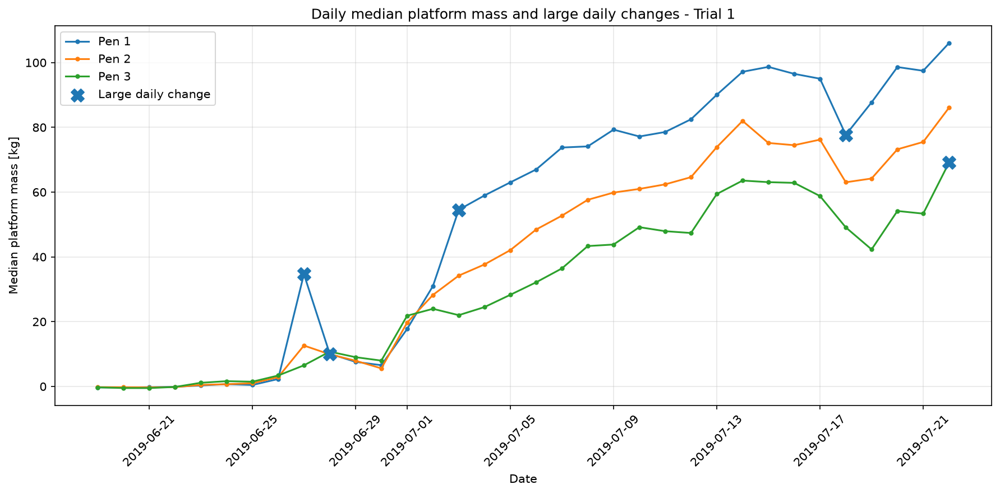
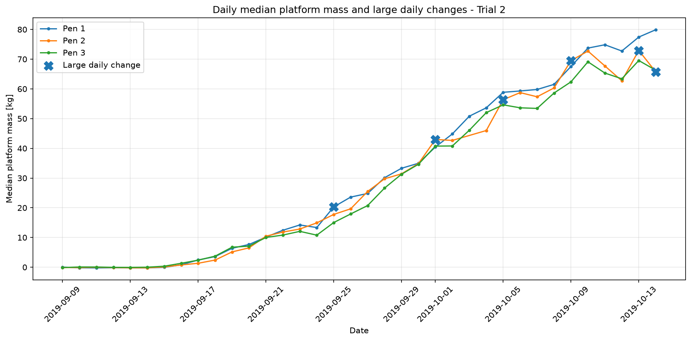
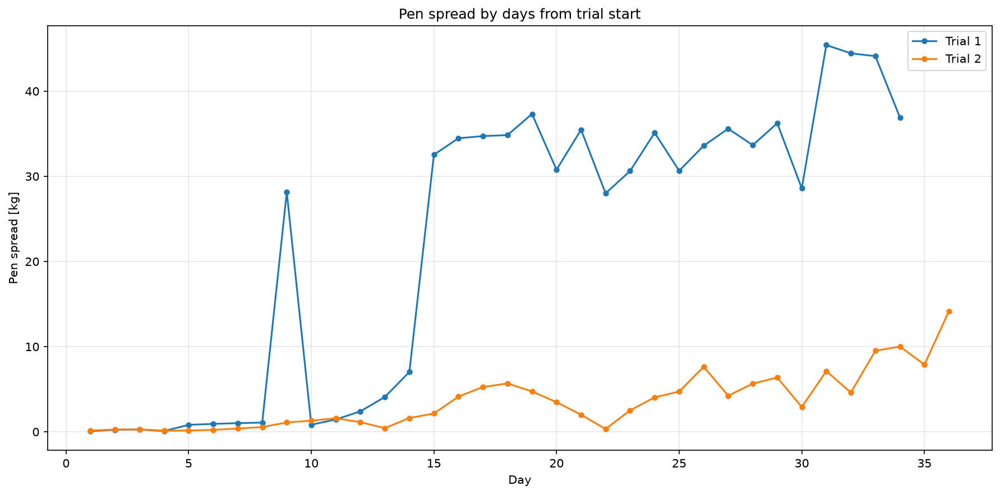
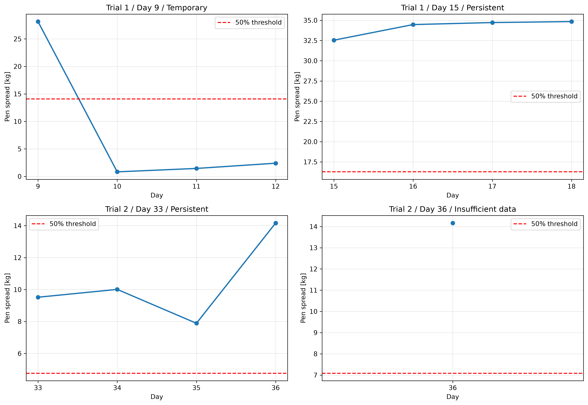
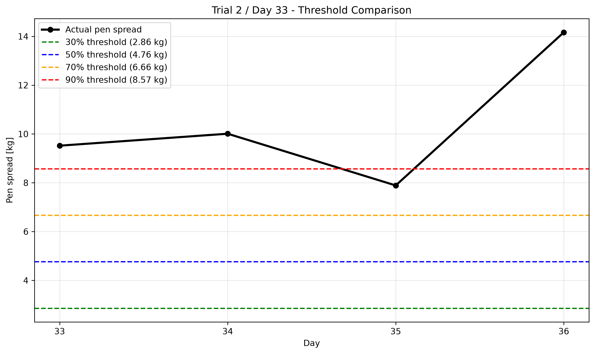

# Broiler Monitoring Analysis

## プロジェクト概要

ブロイラー（食肉用に飼育される鶏）の飼育施設に設置された計量プラットフォームの荷重データを分析し、飼育区画ごとの測定値の違いや、通常とは異なる変化を可視化・検出するデータ分析プロジェクトです。

飼育現場で蓄積されるセンサーデータから、確認が必要な日や期間を効率的に見つけ出し、飼育担当者による状況確認を支援することを目的としています。

Python・pandas・SQLを使用した時系列分析に加え、分析結果を直感的に確認できるStreamlitの対話型ダッシュボードを開発しました。

### 公開アプリ

Streamlit Community Cloudで公開しています。

**[ブロイラー荷重モニタリングダッシュボードを開く](https://broiler-monitoring-analysis.streamlit.app/)**

ブラウザ上でTrialやPen、表示期間を切り替えながら、荷重推移やPen間差、急拡大候補の判定結果を確認できます。

### 主な成果

- Trial 1・Trial 2の荷重データを日次・Pen別に集計
- Pen間差の急拡大候補を探索的なしきい値で検出
- 急拡大後の継続性を3つの区分で判定
- SQLとpandasによる計算結果の整合性を検証
- Trial・Pen・期間を選択できるダッシュボードを実装
- 分析結果をCSV形式でダウンロード可能

※ 本分析は荷重変化のモニタリングを目的としたものであり、鶏の疾病や健康異常を診断するものではありません。

---

## 1. 背景・目的

ブロイラーの飼育では、鶏群の状態や飼育環境の変化を継続的に把握することが重要です。

飼育施設に設置されたセンサーを活用することで、日々の測定データを蓄積できます。しかし、複数の飼育区画から得られる大量のデータを人が個別に確認し、変化を見つけ出すには時間と労力がかかると考えられます。

そこで本プロジェクトでは、計量プラットフォームから取得された荷重データを日単位で集計し、飼育区画ごとの推移や区画間の差を分析しました。

特に、区画間の荷重差が急激に拡大した日を抽出し、その変化が一時的なものか、数日間継続しているものかを判定する仕組みを構築しています。

これにより、飼育担当者が確認すべき日や期間を絞り込み、センサーの測定状況や飼育環境などを確認する際の判断材料を提供することを目指しています。

なお、本分析で扱う荷重は計量プラットフォームで測定された値であり、鶏1羽ごとの体重を示すものではありません。また、荷重の変化だけで鶏の健康状態や異常の原因を特定することはできません。

## 2. 使用データ

本プロジェクトでは、ブロイラーの飼育施設に設置された計量プラットフォームの公開研究データを使用しました。

データは、2回の飼育試験（Trial）で取得されたもので、それぞれ3つの飼育区画（Pen）の測定結果が含まれています。

### 用語の説明

* **Trial（飼育試験）**：データが取得された試験の単位。本プロジェクトではTrial 1とTrial 2を使用しています。
* **Pen（飼育区画）**：鶏を飼育する区画。各TrialにはPen 1〜3のデータが含まれています。
* **プラットフォーム荷重**：鶏が利用する計量プラットフォームに設置されたセンサーで測定された荷重。鶏1羽ごとの体重とは異なります。

### 分析対象

| 飼育試験    | 測定期間                    | 日数  | 飼育区画    |
| ------- | ----------------------- | --- | ------- |
| Trial 1 | 2019-06-19 ～ 2019-07-22 | 34日 | Pen 1〜3 |
| Trial 2 | 2019-09-09 ～ 2019-10-14 | 36日 | Pen 1〜3 |

### 主なデータ項目

| 項目         | 内容                     |
| ---------- | ---------------------- |
| `datetime` | 測定日時                   |
| `pen`      | 飼育区画の番号                |
| `mass[kg]` | 計量プラットフォームで記録された荷重（kg） |

元データは測定件数が多いため、日付・飼育区画ごとに荷重の中央値などを集計したデータを作成し、分析に使用しました。

## 3. 分析の流れ

1. 生データの構造・欠損・測定期間を確認
2. 日付・Pen単位で荷重の中央値などを集計
3. Penごとの成長傾向を可視化
4. 前日からの変化量を算出
5. 通常より大きな変化がみられる日を抽出
6. 同一Trial内のPen間差を算出
7. 一時的な変化と継続的な変化を比較


## 4. プラットフォーム荷重の推移

Trial 1・Trial 2ともに、飼育期間の経過に伴って計量プラットフォームで測定された荷重の中央値が上昇する傾向が確認されました。

ただし、この荷重は鶏1羽ごとの体重を示すものではなく、プラットフォームの利用状況などの影響も受けるため、荷重の増加を鶏の成長によるものと断定することはできません。

Trial 1では飼育区画（Pen）ごとの差や日々の変動が比較的大きく、Trial 2では3つの飼育区画が比較的近い値で推移しました。

### Trial 1



### Trial 2



## 5. 前日変化による確認候補の抽出

各Penの日次中央値について、前日との差を算出した。

Trialごとに日々の変動幅が異なっていたため、
全Trialで同じ固定値を使用するのではなく、
各Trialの前日変化量の絶対値について95%点を探索的なしきい値として使用した。

- Trial 1：14.291 kg
- Trial 2：6.910 kg

この基準以上の変化を「確認候補」として抽出した結果、

- Trial 1：5日
- Trial 2：6日

が確認候補となった。

このしきい値は異常を確定するものではなく、
詳細確認が必要なデータを絞り込むための探索的な基準として使用している。


## 6. Pen間差の分析

同一日におけるPen別中央値について、

**最大値 - 最小値**

をPen間差として算出した。

### Trial 1

- 平均：22.10 kg
- 中央値：30.64 kg
- 最大：45.41 kg

### Trial 2

- 平均：3.57 kg
- 中央値：2.72 kg
- 最大：14.17 kg

Trial 1ではTrial 2と比較してPen間差が大きく、
期間後半では30 kg以上の差が継続して確認された。

一方、Trial 2では3つのPenが比較的近い推移を示した。




## 7. 一時的な変化と継続的な変化

Trial 1では、Pen間差が急激に拡大するケースが確認された。

Day 9ではPen間差が

**1.08 kg → 28.15 kg**

まで拡大したが、翌日には

**0.83 kg**

まで縮小しており、一時的な変化だった。

一方、Day 15では

**7.03 kg → 32.54 kg**

へ急拡大した後も、複数日にわたって30 kg以上のPen間差が継続した。

このことから、単日の変化量だけでなく、
変化後の状態が継続しているかを確認することで、
一時的な変動と継続的な状態変化を区別できる可能性がある。


## 8. モニタリングへの活用

本プロジェクトでは、以下の3つの指標を組み合わせることで、通常とは異なる荷重変化が見られた日や期間を抽出しました。

* **飼育区画ごとの前日変化量**：前日と比較して荷重がどの程度変化したか
* **飼育区画間の荷重差**：同じ日に測定された区画ごとの荷重に、どの程度の違いがあるか
* **荷重差の継続性**：区画間の荷重差が一時的なものか、数日間続いているか

### 飼育現場での活用イメージ

本分析の結果は、飼育担当者が確認すべき日や期間を絞り込むための判断材料として活用できる可能性があります。

例えば、以下のような流れが考えられます。

1. **変化の検出**：センサーデータから、飼育区画間の荷重差が急激に拡大した日を抽出する。
2. **変化の確認**：ダッシュボードで該当日前後の荷重推移を確認し、一時的な変化か、継続している変化かを把握する。
3. **現場での確認**：必要に応じて、計量プラットフォームの動作状況や、鶏によるプラットフォームの利用状況、飼育環境などを確認する。
4. **継続的なモニタリング**：確認結果と測定データを照らし合わせ、同様の変化が繰り返し発生していないかを確認する。

### 期待される効果

* 大量の測定データから、詳しく確認すべき日や期間を絞り込める。
* 荷重の変化をグラフで把握し、飼育区画ごとの違いを比較しやすくなる。
* 一時的な変化と継続的な変化を区別し、現場確認の優先順位を検討する材料になる。

ただし、今回の分析では、実際の飼育現場での運用や作業時間の削減効果までは検証していません。

また、プラットフォーム荷重の変化には複数の要因が考えられるため、検出結果だけで鶏の健康異常や飼育環境の問題を判断することはできません。

本システムは異常の原因を自動診断するものではなく、**飼育担当者による状況確認を支援するための仕組み**として位置づけています。

## 9. モニタリング候補の自動判定

Pen間差の急拡大を検出し、その後の状態が継続しているかを判定する簡易的なモニタリング処理を作成した。

### 判定方法

1. TrialごとにPen間差の前日変化量を算出
2. 前日変化量の95%点以上を急拡大候補として抽出
3. 候補日の翌日から3日間のPen間差を確認
4. 候補日のPen間差の50%以上が3日間維持された場合、継続的な変化と判定

追跡データが不足する場合は、判定不能として扱う。

### 判定結果

| Trial | Day | 判定 |
|---|---|---|
| Trial 1 | 9 | Temporary（一時的） |
| Trial 1 | 15 | Persistent（継続的） |
| Trial 2 | 33 | Persistent（継続的） |
| Trial 2 | 36 | Insufficient data（判定不能） |



### 考察

Trial 1では、一時的なPen間差の拡大と、拡大後も差が継続するケースの両方が確認された。

この結果から、単日の変化量だけでなく、その後の推移を確認することで、異なる変化パターンを分類できる可能性が示された。

なお、判定条件は探索的に設定したものであり、鶏の健康異常を直接示すものではない。

## 10. 判定基準の感度分析

モニタリングの継続判定に使用する基準値について、
30%・50%・70%・90%の4種類を比較した。

### 分析結果

| Trial | Day | 30% | 50% | 70% | 90% |
|---|---|---|---|---|---|
| Trial 1 | 9 | Temporary | Temporary | Temporary | Temporary |
| Trial 1 | 15 | Persistent | Persistent | Persistent | Persistent |
| Trial 2 | 33 | Persistent | Persistent | Persistent | Temporary |
| Trial 2 | 36 | 判定不能 | 判定不能 | 判定不能 | 判定不能 |

### 可視化



### 考察

Trial 2のDay 33では、30〜70%の基準では継続的な変化と判定されたが、
90%では一時的な変化と判定された。

このことから、判定基準によって結果が変化するケースが存在することが確認された。

一方、Trial 1のDay 9とDay 15では、すべての基準で判定が一致した。

今回の分析は判定基準に対する感度を確認したものであり、
最適な基準値や鶏の健康異常を特定するものではない。

## 11. SQLによるデータ管理・分析

Pythonで作成した日次集計データをSQLiteに保存し、
SQLを使用したデータ集計・時系列分析を実施した。

### 実施内容

- 日次集計データ209件をSQLiteに格納
- GROUP BYによるTrial別・Pen別の集計
- ウィンドウ関数LAG()による前の記録との差分計算
- WITH句とABS()を使用した変化量上位10件の抽出
- Pen間差の急拡大候補4件を再現
- pandasとSQLの計算結果を比較・検証

### 分析結果

Trial 1では、Trial 2と比較してPen間の平均値の差が大きく、
日次中央値の変化量上位10件もすべてTrial 1に集中していた。

SQLとpandasで算出したPen間差を70日分比較した結果、
最大誤差は約7.11 × 10^-15となり、
許容誤差0.001未満ですべて一致した。

### 考察

SQLによるデータ管理・集計とPythonによる分析を組み合わせ、
異なる処理方法でも同等の結果が得られることを確認した。

なお、プラットフォーム荷重の変化は、
鶏の健康異常を直接示すものではない。

## 12. 注意点・今後の課題

- 95%点は探索的に設定したしきい値であり、異常を確定する基準ではない
- 荷重変化の原因については、本データのみでは特定できない
- 飼育管理情報やセンサー状態など、他の情報との照合が必要
- Trial 2では2019-10-03のPen 2データが存在しない
- 今後はモニタリング指標の妥当性や、継続的な変化を判定する方法を検討する


## 13. 使用技術

| 分類 | 技術 | 用途 |
|---|---|---|
| プログラミング言語 | Python | データ加工・分析・アプリ開発 |
| データ処理 | pandas、NumPy | 日次集計・時系列分析 |
| データベース・SQL | SQLite、SQL | データ集計・分析結果の検証 |
| 可視化 | Matplotlib、Altair | 分析グラフ・対話型グラフ |
| Webアプリ | Streamlit | ダッシュボードの開発 |
| 開発環境 | Jupyter Notebook、VS Code | 分析・実装 |
| バージョン管理 | Git、GitHub | ソースコード管理 |


## 14. ディレクトリ構成

```text
broiler-monitoring-analysis/
├── app.py                       # Streamlitダッシュボード
├── README.md                    # プロジェクトの説明
├── requirements.txt             # 必要なPythonライブラリ
├── .gitignore                   # Git管理から除外するファイル
├── src/
│   └── prepare_daily_data.py    # 日次集計データの生成
├── notebooks/
│   ├── 01_data_overview.ipynb
│   ├── 02_growth_anomaly_analysis.ipynb
│   ├── 03_monitoring_detection.ipynb
│   ├── 04_threshold_validation.ipynb
│   └── 05_sql_analysis.ipynb
├── data/
│   ├── raw/                     # 元データ（Git管理対象外）
│   ├── interim/                 # 日次集計データ（Git管理対象外）
│   └── processed/               # 加工データ（Git管理対象外）
└── images/                      # 分析結果の画像
```

※ 元データはGitHubに含めていません。中間データのうち、Streamlitダッシュボードで使用する日次集計CSV（Trial 1・Trial 2）のみ公開しています。

## 15. Streamlitダッシュボード

本プロジェクトでは、Pythonによる分析結果を視覚的に確認できるよう、Streamlitを使用したWebダッシュボードを作成しました。


### 主な機能

- **Trialの切り替え**：Trial 1・Trial 2を選択して表示
- **Penの選択**：表示するPenを複数選択可能
- **期間の指定**：開始日・終了日を指定して表示範囲を変更
- **分析サマリー**：表示期間の日数・対象Pen数・選択期間内の急拡大候補数を表示
- **Pen別の荷重推移**：プラットフォーム荷重の日次中央値を折れ線グラフで可視化
- **Pen間差の可視化**：同一Trial内のPen間差の推移を表示
- **急拡大候補の検出**：Pen間差の前日からの増加量について95パーセンタイル以上となる日を抽出
- **検出結果の強調表示**：急拡大候補をグラフ上に赤い点で表示
- **継続性の判定**：Persistent・Temporary・Insufficient dataに分類
- **判定基準の変更**：継続性の判定基準を変更可能
- **CSVダウンロード**：継続性の判定結果をExcelでも確認できるCSV形式で出力

### 分析上の注意点

本ダッシュボードは、プラットフォーム荷重の変化を探索的に分析するためのものです。

検出された急拡大候補は、鶏の疾病や健康異常を直接示すものではありません。

Penの選択は「Pen別の荷重推移」の表示に反映されます。一方、Pen間差・急拡大候補の検出・継続性判定は、選択したTrialの全Penを対象として計算しています。

期間指定はグラフや候補一覧の表示範囲に反映されますが、急拡大候補の検出基準と継続性判定はTrial全期間のデータを使用します。

### ローカル環境での起動方法

Pythonがインストールされた環境で、以下の手順を実行します。

**1. リポジトリを取得**

```bash
git clone https://github.com/yuka-m-sora/broiler-monitoring-analysis.git
cd broiler-monitoring-analysis
```

**2. 仮想環境を作成・有効化（Windows PowerShell）**

```powershell
python -m venv .venv
.\.venv\Scripts\Activate.ps1
```

**3. 必要なライブラリをインストール**

```powershell
python -m pip install -r requirements.txt
```

**4. 元データを配置**

本リポジトリには元データを含めていませんが、Streamlitダッシュボードで使用する日次集計CSVは含まれています。

元データから集計処理を再現する場合は、「データセット・出典」に記載したZenodoからTrial 1・Trial 2のデータを取得してください。

「データセット・出典」に記載したZenodoからTrial 1・Trial 2のデータを取得し、展開した日別CSVファイルを以下の場所に配置してください。

```text
data/raw/
├── trial1/
│   ├── 2019-06-19.csv
│   └── ...
└── trial2/
    ├── 2019-09-09.csv
    └── ...
```

**5. 日次集計データを生成**

プロジェクトのルートディレクトリで、以下のコマンドを実行します。

```powershell
python src/prepare_daily_data.py
```

このスクリプトでは、各Trialの日別CSVを読み込み、日付・Penごとに以下の項目を集計します。

- 測定件数
- 荷重の最小値・中央値・最大値
- 10kgを超える測定値の件数

集計結果は以下に保存されます。

```text
data/interim/
├── trial1_daily_quality_summary.csv
└── trial2_daily_quality_summary.csv
```

集計結果については、Notebookによる計算結果との一致を確認しています。

**6. Streamlitを起動**

```powershell
python -m streamlit run app.py
```

ブラウザで表示されたローカルURLにアクセスすると、ダッシュボードを操作できます。

## 16. データセット・出典

本プロジェクトでは、ブロイラー鶏舎に設置された計量システムの公開研究データを使用しています。

**データセット名**

Supplementary dataset to publication: "Elevated platforms with integrated weighing beams allow automatic monitoring of usage and activity in broiler chickens"

**公開元**

Zenodo（2023年）

https://zenodo.org/records/7783989

**使用データ**

- Trial 1：2019年6月19日〜7月22日
- Trial 2：2019年9月9日〜10月14日

各Trialのプラットフォーム荷重データを日次・Pen別に集計し、荷重の推移やPen間差の変化を分析しています。


### データの取り扱い・ライセンス

本プロジェクトでは、Zenodoで公開されている研究データを使用しています。

- データセット：Supplementary dataset to publication: "Elevated platforms with integrated weighing beams allow automatic monitoring of usage and activity in broiler chickens"
- 出典：https://zenodo.org/records/7783989
- ライセンス：Creative Commons Attribution 4.0 International（CC BY 4.0）
- ライセンス本文：https://creativecommons.org/licenses/by/4.0/
- 著作者：Helen Schomburg, Julia Malchow, Oliver Sanders, Jonas Knöll, Lars Schrader

元データを日付・Pen単位で集計し、プラットフォーム荷重の中央値やPen間差などを分析しています。

本リポジトリには、分析用に加工した日次集計CSVのみを含め、元データは含めていません。